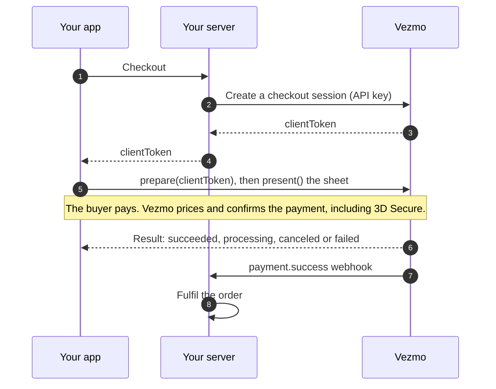

# Vezmo Mobile SDK

[](https://github.com/vezmoPay/vezmo-mobile-sdk/actions/workflows/react-native.yml)
[](https://github.com/vezmoPay/vezmo-mobile-sdk/actions/workflows/react-native-e2e.yml)
[](https://github.com/vezmoPay/vezmo-mobile-sdk/actions/workflows/ios.yml)
[](https://github.com/vezmoPay/vezmo-mobile-sdk/actions/workflows/android.yml)
[](https://github.com/vezmoPay/vezmo-mobile-sdk/actions/workflows/flutter.yml)
[](https://www.npmjs.com/package/@vezmopay/react-native)
[](https://pub.dev/packages/vezmo_checkout)
[](https://central.sonatype.com/artifact/com.vezmo/vezmo-checkout)
[](packages/ios#readme)
[](LICENSE)

Take payments in your iPhone and Android apps with Vezmo, in a native payment sheet: cards with 3D Secure, Apple Pay,
Google Pay, Instant ACH, Klarna, Affirm, Afterpay, Amazon Pay, Cash App, UPI and Pix, in the buyer's own currency.
Start subscriptions too, with a free trial or a first payment, and the card or bank account saved for the renewals.


<sub>Screens from the example apps against Vezmo's sandbox, as the end-to-end tests capture them.</sub>

## Choose your SDK

| Your app | Package | Install | Guide |
| --- | --- | --- | --- |
| React Native or Expo | [`@vezmopay/react-native`](packages/react-native) | `npx expo install @vezmopay/react-native` | [README](packages/react-native#readme) · [online guide](https://user.vezmo.com/docs/v1/mobile/react-native) |
| iOS, Swift (SwiftUI or UIKit) | [`VezmoCheckout`](packages/ios) Swift package | Xcode → Add Package Dependencies → this repository's URL | [README](packages/ios#readme) · [online guide](https://user.vezmo.com/docs/v1/mobile/ios) |
| Android, Kotlin (Compose or Views) | [`com.vezmo:vezmo-checkout`](packages/android) | `implementation("com.vezmo:vezmo-checkout:0.1.0")` | [README](packages/android#readme) · [online guide](https://user.vezmo.com/docs/v1/mobile/android) |
| Flutter | [`vezmo_checkout`](packages/flutter) (on the native SDKs) | `flutter pub add vezmo_checkout` | [README](packages/flutter#readme) · [online guide](https://user.vezmo.com/docs/v1/mobile/flutter) |

All four draw the same sheet and return the same results. Apps without an SDK can open Vezmo's hosted checkout in the
phone's secure browser sheet instead ([Checkout for apps](https://user.vezmo.com/docs/v1/mobile/checkout-for-apps)).

### Requirements

| | Minimum |
| --- | --- |
| React Native | React Native 0.79 with the New Architecture; Expo SDK 53 with a development build (not Expo Go) |
| iOS | iOS 15.1, Xcode 16, Swift 5.9 |
| Android | Android 7.0 (API 24); compile SDK 36, Kotlin 2.1, Java 17 |
| Flutter | Flutter 3.41 (Dart 3.11) |

Every app also needs a Vezmo business with your app added under **Developers → Mobile apps** in the dashboard. On
iPhone that is where you register the return link (for example `acme://vezmo`) the buyer comes back through after
3D Secure, a bank app or a pay-later provider.

## What the sheet does

- **Payment methods**: cards with 3D Secure and card scanning, Apple Pay, Google Pay, Instant ACH (a US bank account,
  in US dollars), Klarna, Affirm, Afterpay, Amazon Pay, Cash App, UPI (India) and Pix (Brazil). The sheet shows the
  methods your business offers that work for the buyer.
- **The buyer's own currency**: the buyer can choose to see and pay the total in their own currency, where Vezmo
  offers one.
- **Subscriptions**: a free trial (the card is saved, nothing is charged today) or a first payment, with the renewals
  charged by Vezmo. Apple Pay shows the recurring terms on iOS 16 and later.
- **Native look**: light and dark mode, the phone's text size, screen reader labels, and your own colors, corner
  radius and font.
- **Results your app can act on**: `succeeded`, `processing` (UPI, Pix or a bank debit still settling), `canceled`
  or `failed`, with an error code. The sheet never throws.

## How a payment works



1. Your server creates an API checkout session (`POST /api/v1/merchant/secure-payments`) with your Vezmo API key and
   sends its client token (`data.securePayment.clientToken`) to the app. For a subscription it creates the
   subscription (`POST /api/v1/merchant/subscription`) and sends its `checkoutToken`.
2. The app prepares the sheet with that token and presents it.
3. The buyer pays. Vezmo's servers price and confirm the payment; the app gets the result.
4. Your server fulfils the order from the `payment.success` webhook (or `subscription.*` for subscriptions), not from
   the app's result alone.

Your API key and secret stay on your server. The app only ever holds a session's client token.

In React Native, for example:

```tsx
const { prepareCheckout, presentCheckout } = useVezmoCheckout();

const prep = await prepareCheckout({ clientToken });
if (prep.error) return showError(prep.error.message);

const result = await presentCheckout(); // 'succeeded' | 'processing' | 'canceled' | 'failed'
```

The [iOS](packages/ios#take-a-payment), [Android](packages/android#take-a-payment) and
[Flutter](packages/flutter#take-a-payment) READMEs have the same steps in Swift, Kotlin and Dart.

## Try it in the sandbox

Create sessions with your sandbox API key, then pay with:

| Card | What happens |
| --- | --- |
| `4242 4242 4242 4242` | Paid. 3D Secure, when asked, shows a test page where you approve or fail it. |
| `4000 0000 0000 3220` | Always asks for 3D Secure. |
| `4000 0000 0000 0002` | Declined. |

Any future expiry date and any CVC. In the sandbox, Apple Pay and Google Pay use the cards in the phone's wallet
without charging them. For Instant ACH, choose the **Success** test bank, and enter any six digits when asked for a
code.

Each package has an example app (a small shop called Northwind Audio) that pays against Vezmo's sandbox:

| Example | Run it |
| --- | --- |
| [React Native](packages/react-native/example) | `yarn example expo run:ios` or `yarn example expo run:android` from `packages/react-native` |
| [iOS](packages/ios/Example) | `xcodegen generate` in `packages/ios/Example`, then open `VezmoExample.xcodeproj` |
| [Android](packages/android/example) | `gradle :example:installRelease` from `packages/android`, or install `example-apk` from the latest [Android SDK run](https://github.com/vezmoPay/vezmo-mobile-sdk/actions/workflows/android.yml?query=branch%3Amain) |
| [Flutter](packages/flutter/example) | `flutter run` from `packages/flutter/example` |

## Repository layout

```text
packages/
  react-native/   @vezmopay/react-native: TypeScript, native modules, Expo config plugin, example app, Maestro flows
  ios/            VezmoCheckout: Swift sources, unit tests, example app (XcodeGen), Maestro flows
  android/        vezmo-checkout: Kotlin library, example app, Maestro flows
  flutter/        vezmo_checkout: Dart plugin on the iOS and Android SDKs, tests, example app, Maestro flows
Package.swift     Swift Package Manager manifest for the iOS SDK (at the root so the repository URL installs it)
.github/          CI, end-to-end, release and TestFlight workflows
```

CI runs each package's tests on its pull requests and on `main`, and pays end to end from the example apps on an
Android emulator and an iPhone simulator with [Maestro](https://maestro.dev): cards with 3D Secure, a decline, cancel,
a bad token, both business models, a Cash App redirect back into the app, Instant ACH, subscriptions with and without a
free trial, and dark mode. [CONTRIBUTING.md](CONTRIBUTING.md#ci) lists what each workflow covers.

## Versions

The SDKs are 0.x: a minor release (0.1 → 0.2) can change the API, so pin to a minor version. Each package's
`CHANGELOG.md` lists its changes: [React Native](packages/react-native/CHANGELOG.md),
[iOS](packages/ios/CHANGELOG.md), [Android](packages/android/CHANGELOG.md), [Flutter](packages/flutter/CHANGELOG.md).
Maintainers release in the order in [RELEASING.md](RELEASING.md).

## Help and security

- **Questions about your Vezmo account, payments or payouts**: [support@vezmo.com](mailto:support@vezmo.com).
- **A bug in an SDK**: [open an issue](https://github.com/vezmoPay/vezmo-mobile-sdk/issues/new/choose)
  with the SDK, its version and the phone.
- **A security problem**: report it privately, never in a public issue; see [SECURITY.md](SECURITY.md).
- **Contributing**: see [CONTRIBUTING.md](CONTRIBUTING.md).

## License

[MIT](LICENSE)
